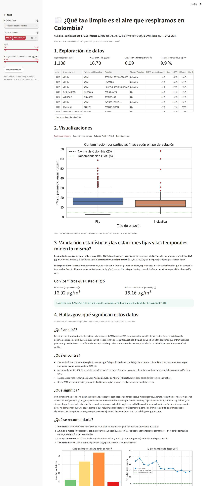

# 🌫️ Calidad del aire en Colombia (PM2.5): dashboard interactivo

Dashboard en Streamlit que comunica, a una audiencia no técnica, los resultados del análisis exploratorio de datos (EDA) de la Tarea 3 del curso *Programación para el análisis de datos* (UNAD).

## Descripción del proyecto

El análisis trata sobre la **calidad del aire en Colombia**, con foco en las partículas finas **PM2.5**, que por su tamaño llegan hasta los pulmones y se asocian con enfermedades respiratorias y cardiovasculares. Se usó el conjunto de datos abiertos *Calidad del Aire en Colombia (Promedio Anual)* del IDEAM, publicado en [datos.gov.co](https://www.datos.gov.co/Ambiente-y-Desarrollo-Sostenible/Calidad-Del-Aire-En-Colombia-Promedio-Anual-/kekd-7v7h): 15.323 registros únicos (tras eliminar duplicados) de 516 estaciones y 24 departamentos, entre 2011 y 2024.

Se eligió porque es una fuente oficial, abierta y real, con cobertura nacional, dimensión temporal y georreferenciación, y porque su tema tiene impacto directo en la salud pública.

El dashboard **no es un análisis nuevo**: presenta los mismos datos y conclusiones del EDA, de forma interactiva. Incluye filtros (departamento, tipo de estación, años y rango de PM2.5), métricas, tabla filtrable, cuatro visualizaciones, la validación estadística (prueba t) explicada en lenguaje claro y una narrativa de hallazgos en cuatro preguntas: ¿qué analicé?, ¿qué encontré?, ¿qué significa? y ¿qué se recomendaría?

## Captura de pantalla



## Dashboard publicado

👉 **[Abrir el dashboard]https://dashboard-interactiva-calidad-del-aire-en-colombia-ekv5h7p4v2k.streamlit.app/#3-validacion-estadistica-las-estaciones-fijas-y-las-temporales-miden-lo-mismo

## Hallazgos principales

1. El PM2.5 típico es de ~16 µg/m³: cumple la norma colombiana (25) pero triplica la recomendación de la OMS (5).
2. Cerca del 10 % de las mediciones anuales supera la norma colombiana; las zonas más críticas son Antioquia (Valle de Aburrá) y Bogotá.
3. Las estaciones fijas registran algo más de PM2.5 que las indicativas (16,9 vs. 15,2 µg/m³; prueba t, p = 0,005), diferencia pequeña explicada por *dónde y cuánto tiempo* se mide.
4. El PM2.5 se asocia moderadamente con el NO₂, el CO y el PM10, lo que apunta al tráfico como posible fuente común (asociación, no causalidad demostrada).
5. La tendencia es descendente desde 2016, pero la red pasó de 13 a más de 140 estaciones, por lo que parte de la mejora puede ser un efecto de la ampliación de la red.

## Estructura del repositorio

| Archivo | Contenido |
|---|---|
| `app.py` | Código del dashboard |
| `dataset.csv` | Datos del IDEAM (~10 MB) |
| `requirements.txt` | Dependencias |
| `capturas/` | Capturas del dashboard |

## Instalación y ejecución local

```bash
# 1. Clonar el repositorio
git clone <https://github.com/EmanuelVDesarrollo/Dashboard-Interactiva-Calidad-del-Aire-en-Colombia.git>
cd <carpeta-del-repositorio>

# 2. (Opcional) crear un entorno virtual
python -m venv .venv
.venv\Scripts\activate        # Windows
source .venv/bin/activate     # macOS / Linux

# 3. Instalar dependencias
pip install -r requirements.txt

# 4. Ejecutar
streamlit run app.py
```

Abrir <http://localhost:8501> en el navegador.

## Autoría

**Estudiante:** Francisco José Velandia Rincón · **Curso:** Programación para el análisis de datos (203238834) · **Universidad:** Universidad Nacional Abierta y a Distancia (UNAD) · **Fecha:** noviembre de 2026
